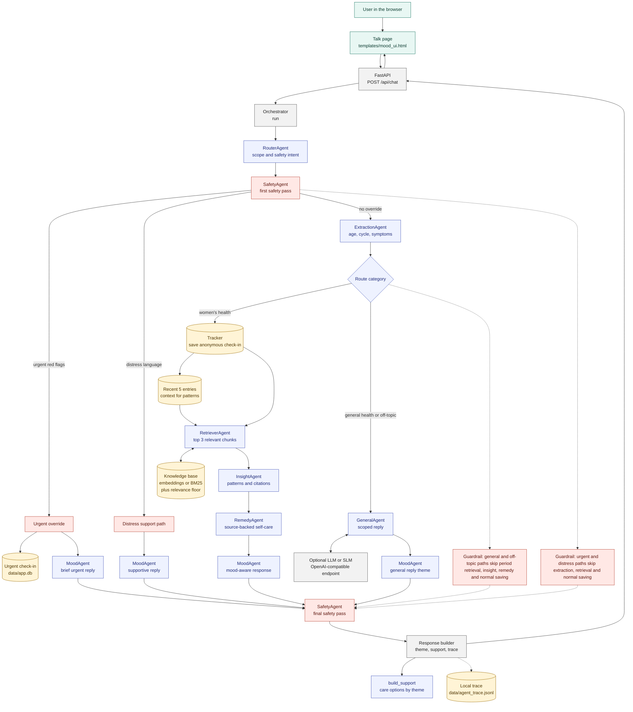

# recHERsion MVP

[](https://github.com/Tenisha5132/recHERsion_Unhandled_Exceptions/actions/workflows/tests.yml)

## Problem
recHERsion MVP is a multi-agent RAG app for PS1 "Women's Healthcare" (gaps in diagnosis, symptom tracking, health awareness, access to clinical insights). This app is screening/awareness support only — not a diagnosis.

## Architecture (ASCII)
```
User (Browser) -> FastAPI (app.py)
                    |-> Orchestrator
                        |-> router -> safety(1) -> extraction
                        |     |-> women's health: tracker(save) -> retriever -> insight -> remedy -> mood -> safety(2)
                        |     |-> general/off-topic: general -> mood -> safety(2)
                    |-> SQLite (tracker.py)
                    |-> RAG (ingest.py, retriever.py) using knowledge_base/ + embeddings/BM25
                    |-> Optional OpenAI-compatible LLM/SLM (llm_client.py)
                    |-> Templates/Static (HTML/CSS/JS pages)
                    |-> PDF summary (summary_pdf.py via reportlab)
```

## Setup
```bash
python -m venv .venv
source .venv/bin/activate
pip install -r requirements.txt
cp .env.example .env
```

Semantic embeddings are optional. Without them the app uses BM25:
```bash
pip install -r requirements-embeddings.txt
```

## Run
```bash
make run
# or
./run.sh
# or
uvicorn app:app --host 0.0.0.0 --port 8000
```

## Scope-aware replies
The router keeps menstrual and reproductive health separate from general health:

- Period, cycle, bleeding, pelvic pain, fertility, pregnancy and menopause messages use the KB-grounded RAG path.
- A cold, cough, headache or other general symptom gets a general-health reply and GP/pharmacy support, without unrelated period sources.
- Off-topic messages get a short scope reply and no care cards.
- Urgent red flags and distress language still override every other route.
- Retrieval now applies stopword filtering and a relevance floor, so unrelated messages do not receive citations.

## LLM / SLM setup
The app works without a model key. To enable an OpenAI-compatible hosted model or a local SLM, edit `.env`:

```bash
LLM_API_KEY=your-key
LLM_MODEL=gpt-4o-mini
LLM_BASE_URL=https://api.openai.com/v1
```

For a local Ollama-style endpoint:

```bash
LLM_API_KEY=
LLM_MODEL=your-local-model
LLM_BASE_URL=http://localhost:11434/v1
```

The LLM is optional and is used for ambiguous routing and general/off-topic replies. Safety checks, red-flag overrides, retrieval and the women's-health insight path remain rule-based.

## Deployment
`requirements.txt` and `Procfile` are included. A typical hosted setup:

```bash
pip install -r requirements.txt
uvicorn app:app --host 0.0.0.0 --port $PORT
```

Set `LLM_API_KEY`, `LLM_MODEL`, `LLM_BASE_URL`, `LLM_TIMEOUT`, `MIN_RETRIEVAL_SCORE` and `COOKIE_SECURE` in the host environment. Do not commit `.env`. Attach a persistent disk if saved journal entries must survive restarts, because SQLite is stored at `data/app.db`.

The health endpoint is `GET /healthz`. After deployment, verify the running app:

```bash
python scripts/smoke_test.py --base-url https://your-host
```

### Docker
```bash
docker build -t rechersion .
docker run --rm -p 8000:8000 --env-file .env rechersion
```

The image runs as a non-root user and checks `/healthz` with Docker's healthcheck. Mount a private volume at `/app/data` if you need durable journal storage.

## Tests
```bash
make check
# or
python -m unittest discover -s tests -v
```

The suite covers extraction, scope routing, retrieval relevance, general replies, config parsing, LLM fallbacks, cookies, tracker access, deployment health, security headers and page contracts. GitHub Actions runs it on Python 3.11 and 3.12.

## Pages
The app is split into focused pages instead of one long screen:

- `/` — private chat, mood theming and support cards
- `/sounds` — built-in soundscapes plus your own local music uploads
- `/timeline` — saved journal entries, PDF summary and delete controls
- `/support` — emergency numbers, helplines and nearby-care map searches
- `/privacy` — what is stored, what stays in the browser and what leaves the device
- `/login` — optional display-name cookie; no password or email

## Workflows
Source files: [multi-agent workflow](docs/multi_agent_workflow.mmd) and [features and guardrails](docs/features_and_guardrails.mmd).

### Multi-agent workflow


### Features and guardrails

```mermaid
flowchart LR
    subgraph FEATURES["Features added"]
        direction TB
        NAV["Multi-page shell<br/>Talk, Sounds, Journal, Support, Privacy"]
        CHAT["Chat screening<br/>POST /api/chat"]
        SCOPE["Scope-aware routing<br/>women's health, general health, off-topic"]
        MODEL["Optional LLM or SLM<br/>OpenAI-compatible endpoint"]
        MOOD["Mood-aware UI<br/>result cards and gentle audio"]
        KBQ["Knowledge-base insight and remedy<br/>patterns, questions, sources"]
        SOUNDS["Sound library<br/>15 ambient profiles"]
        PLAYER["Player controls<br/>volume, loop, sleep timer"]
        UPLOAD["Own music<br/>IndexedDB uploads, 20 MB limit"]
        JOURNAL["Journal<br/>timeline, PDF summary, delete"]
        SUPPORT["Support page<br/>112, Tele-MANAS, findahelpline, maps"]
        LOGIN["Name-only login<br/>display-name cookie"]
        PRIVACY["Privacy page<br/>plain-language disclosures"]
        WARM["Generated WAV route<br/>background warmup, gitignored audio"]
        HEALTH["Deployment checks<br/>GET /healthz and smoke script"]
        OPS["Docker image and CI<br/>Python 3.11 and 3.12"]
        SECURE["Hardened transport<br/>security headers, request IDs, cookies"]
    end

    subgraph GUARDRAILS["Guardrails kept"]
        direction TB
        G1["Safety passes before<br/>and after the agents"]
        G2["Urgent red flags<br/>override the normal flow"]
        G3["Distress is not saved<br/>only the urgent override persists"]
        G4["No diagnosis<br/>diagnostic claims are stripped"]
        G5["No medication advice<br/>unsafe remedy text is filtered"]
        G6["Clinical advice stays KB-grounded<br/>with source citations"]
        G7["Rule-based agents work<br/>without an LLM key"]
        G8["Optional LLM path documents<br/>de-identified text sharing"]
        G9["Verified helplines only<br/>TODO placeholders are hidden"]
        G10["Map results marked unvetted<br/>location stays in the browser"]
        G11["Uploads stay local<br/>never sent to the server"]
        G12["No autoplay<br/>urgent state skips audio"]
        G13["Anonymous ID cookie<br/>no password, email, or phone"]
        G14["Local debug trace<br/>disclosed on the privacy page"]
        G15["Not-a-diagnosis disclaimer<br/>on relevant pages"]
        G16["94 automated tests<br/>scope, safety, support, login, sounds, pages"]
        G17["Sound framed as comfort<br/>not treatment"]
        G18["Under-18 support adds<br/>adolescent-friendly care options"]
        G19["General and off-topic replies<br/>skip unrelated period retrieval"]
        G20["HTTP-only SameSite cookies<br/>security headers on every response"]
    end

    CHAT --> G1
    CHAT --> G2
    CHAT --> G7
    CHAT --> G8
    SCOPE --> G7
    SCOPE --> G19
    MODEL --> G8
    KBQ --> G4
    KBQ --> G5
    KBQ --> G6
    KBQ --> G15
    MOOD --> G12
    SOUNDS --> G12
    PLAYER --> G12
    WARM --> G12
    SOUNDS --> G17
    UPLOAD --> G11
    JOURNAL --> G3
    JOURNAL --> G13
    SUPPORT --> G9
    SUPPORT --> G10
    SUPPORT --> G18
    LOGIN --> G13
    PRIVACY --> G14
    PRIVACY --> G15
    NAV --> G16
    HEALTH --> G16
    OPS --> G16
    SECURE --> G13
    SECURE --> G20

    classDef feature fill:#e8f7f3,stroke:#12705c,color:#0b3b30
    classDef guard fill:#ffe8e5,stroke:#b33a2b,color:#5c160e
    class NAV,CHAT,SCOPE,MODEL,MOOD,KBQ,SOUNDS,PLAYER,UPLOAD,JOURNAL,SUPPORT,LOGIN,PRIVACY,WARM,HEALTH,OPS,SECURE feature
    class G1,G2,G3,G4,G5,G6,G7,G8,G9,G10,G11,G12,G13,G14,G15,G16,G17,G18,G19,G20 guard
```


## Seed
```bash
make seed
# or
python seed.py
```

## Ingest KB
```bash
make ingest
# or
python ingest.py
```

## Sound library
The `/sounds` page includes 15 generated ambient loops: calm, focus, sleep, breathing, grounding, nature, noise, uplift and mindful categories. The WAV files are generated locally on first use by `sounds.py`; they are not committed to git.

- The built-in player supports volume, looping and a 15/30/60/90 minute sleep timer.
- Your own music can be added with the file picker.
- Uploaded audio stays in the browser using IndexedDB. It is not uploaded to the server.
- Removing a track deletes it from that browser.
- Audio is a comfort tool, not treatment.

## Agents
- router: classify message as women's health, general health, off-topic, urgent or distress
- safety: red flags + distress first and last; strips diagnostic claims
- extraction: free text -> structured JSON with nulls
- retriever: top-3 relevant chunks + recent log entries, with a relevance floor
- insight: rules-based, cites chunks, age-aware, suggests pregnancy test when relevant, never diagnoses
- remedy: safe self-care from KB only
- general: non-period health replies, using an optional LLM or a safe rules fallback
- mood: deterministic, jokes only for mild non-pain cases when safe

## Operations and troubleshooting
- `GET /healthz` reports the app version, retrieval backend, chunk count, and whether an LLM is configured. It never returns a key.
- `COOKIE_SECURE=true` is required behind HTTPS. Anonymous and display-name cookies are HTTP-only and SameSite=Lax.
- Security headers and `X-Request-ID` are attached to every HTTP response. Use the request ID when comparing a browser error with server output.
- If a cold or general-health message still mentions periods, check `tests/test_general_route.py` and `MIN_RETRIEVAL_SCORE`; general and off-topic routes must skip retrieval.
- If the model is not used, check `GET /healthz` and confirm `LLM_API_KEY` or `LLM_BASE_URL` is set in the running process. Rules fallback is expected without either.
- Generated sounds are gitignored and created on first use. If `/media/sounds/...` fails, confirm `static/sounds/` is writable by the app user.
- See [API contract](docs/API.md), [contributing](CONTRIBUTING.md) and [security policy](SECURITY.md).

## Privacy & Limitations
- No names/emails/phone. anonymous_user_id in browser cookie. Data in local SQLite DB.
- If LLM key set, de-identified message text may be sent to provider.
- Not a medical device, not diagnosis. Synthetic eval only.
- LLM fallback behavior: app runs without key with rule-based fallbacks; UI/trace indicate fallback.
- Clinical content only from knowledge_base/ built from provided sources.
- Thresholds in rules.yaml with source_url/kb_file or TODO_VERIFY; features degrade gracefully.

## Credits
### Libraries
- FastAPI, Uvicorn, Jinja2, python-multipart - ASGI/web
- PyYAML - rules/config
- sentence-transformers (all-MiniLM-L6-v2) - optional embeddings
- rank_bm25 - BM25 fallback
- numpy - cosine similarity
- reportlab - PDF
- sqlite3 - storage

### Models
- sentence-transformers/all-MiniLM-L6-v2 (Apache 2.0)

### Knowledge base sources
- https://www.nhs.uk/conditions/heavy-periods/
- https://www.nhs.uk/conditions/heavy-periods/diagnosis/
- https://www.nhs.uk/conditions/irregular-periods/
- https://www.nhs.uk/conditions/irregular-periods/treatment/
- https://www.who.int/news-room/fact-sheets/detail/polycystic-ovary-syndrome
- https://www.nhs.uk/conditions/polyendocrine-metabolic-ovarian-syndrome-pmos/
- https://www.nhs.uk/conditions/endometriosis/
- https://www.nhs.uk/conditions/underactive-thyroid-hypothyroidism/
